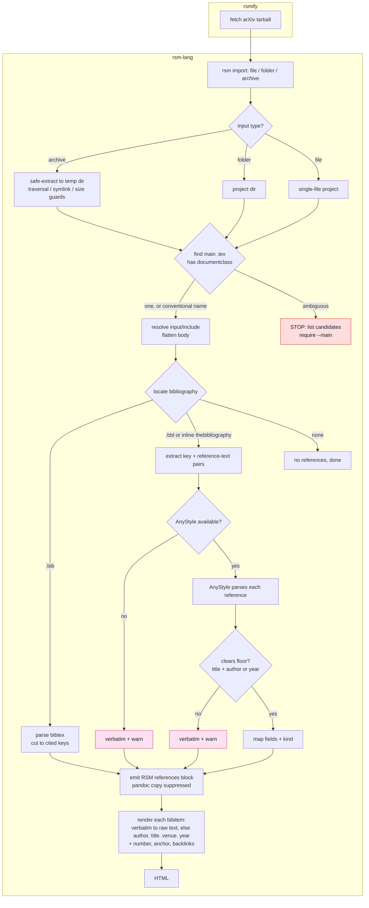

# Bibliography import flow

How `rsm import` turns a LaTeX file, folder, or arXiv tarball into a rendered RSM
references block. The bibliography is handled outside pandoc (pandoc drops the
`\bibitem` keys), extracted from the raw source, and spliced in.

Pink nodes emit an RSM log warning; the red node is a hard stop.

## Notes

- **Parser.** `.bib` if present, parsed as bibtex and cut to cited keys, no
  parsing step needed. Otherwise AnyStyle, run as an optional tool rsm-lang
  detects (not a pip dependency), baked into the rsmify and Studio images. With
  no parser installed (a bare CLI install), the document still converts and the
  references render verbatim, with an RSM log warning.
- **Main-file detection.** The `.tex` that declares `\documentclass`. When
  several match and one is chosen by a conventional name (`main`, `ms`,
  `paper`), that choice is logged via the RSM logger so it is not silent. When
  it is still ambiguous, `rsm import` stops and asks for `--main <file>`.
- **Degrade warnings.** Every fall back to a verbatim entry (no parser, a parse
  below the floor, or a parse failure) emits an RSM log warning naming the
  entry's citation key.
